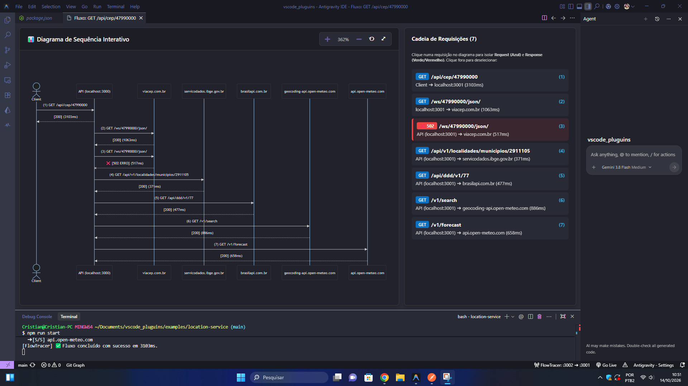
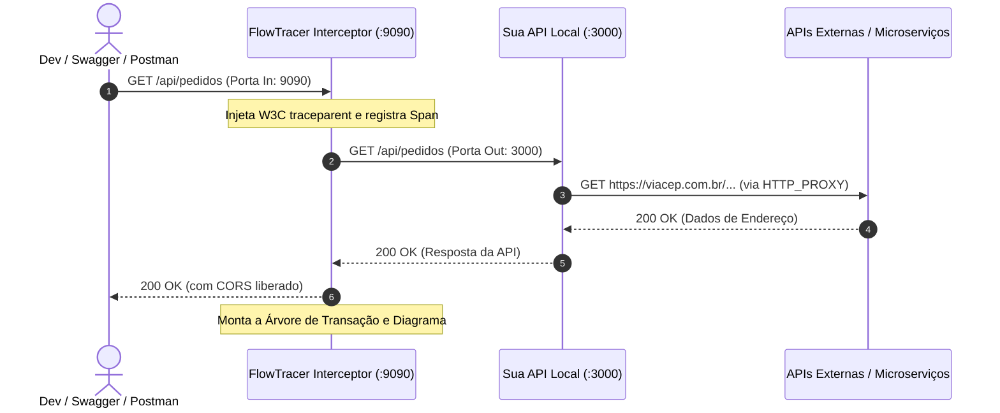

# FlowTracer - API Sequence Visualizer for VS Code & Antigravity IDE

[](https://opensource.org/licenses/MIT)
[](https://marketplace.visualstudio.com/)
[](package.json)

**FlowTracer** é uma extensão de observabilidade e visualização para o **VS Code** e **Antigravity IDE**. Ela intercepta requisições HTTP locais, correlaciona chamadas distribuídas entre microsserviços e APIs terceiras e renderiza automaticamente **diagramas de sequência interativos (Mermaid.js)** com navegação em tempo real, pan & zoom suave, isolamento de pares de chamada e exportação instantânea em **cURL**.

---

## 📸 Demonstração Visual

Veja o FlowTracer em ação capturando um fluxo completo de microsserviço com múltiplas integrações externas:



*Exemplo acima: Uma chamada para `/api/cep/47990000` orquestra consultas em cascata para ViaCEP, IBGE, BrasilAPI e Open-Meteo com detecção de falhas (502 Bad Gateway) destacadas em vermelho.*

---

## ✨ Principais Funcionalidades

- 📊 **Diagramas de Sequência Automáticos (Mermaid.js)**:
  - Visualização clara da cadeia ponta a ponta: `Client ➔ API Local / Microsserviço ➔ APIs Externas`.
  - Mapeamento automático dos nós participantes (removendo portas residuais e agrupando por serviço/domínio).
  - Indicação visual intuitiva de sucesso (códigos 2xx) e erros/falhas (códigos 4xx e 5xx com realce vermelho).

- 🔍 **Inspeção Interativa e Isolamento Visual**:
  - Selecione qualquer chamada no painel lateral ou diretamente no diagrama para isolar visualmente o par correspondente: **Request (Azul Neon)** e linha tracejada de **Response (Verde para sucesso, Vermelho para falha)**.
  - Estabilidade de navegação: o diagrama mantém o nível de zoom e a posição exata durante as interações.

- 🔎 **Pan & Zoom Amplo**:
  - Zoom livre de **10% até 800%** via scroll do mouse ou pelos botões dedicados (`+`, `-`, `Reset`, `Tela Cheia`).
  - Arraste livre (pan) com o botão esquerdo do mouse para explorar diagramas com dezenas de serviços.

- 📋 **Exportação Instantânea com Copy as cURL**:
  - Reproduza e depure qualquer requisição externa da cadeia isoladamente com um clique direto na interface.

- 🔄 **Gateway Reverso Inteligente (In / Out)**:
  - **Porta de Entrada (`In`)**: Onde Swagger, Postman ou seu Frontend disparam as requisições (padrão: `9090` ou configurável).
  - **Porta de Destino (`Out`)**: Onde a sua API backend realmente está executando (padrão: `3000` ou configurável).
  - Suporte completo a **CORS Preflight (`OPTIONS`)** transparente para chamadas via navegadores.

- 🌐 **Rastreamento Distribuído Padrão W3C**:
  - Compatibilidade nativa com qualquer stack e linguagem (Node.js, .NET, Java, Python, Go, Rust, PHP, etc.) via propagação do cabeçalho padrão `traceparent` (`W3C Trace Context`).

- 🖥️ **Integração Nativa com a IDE**:
  - Item interativo na **Barra de Status** inferior mostrando o túnel ativo (`FlowTracer: :In ➔ :Out`).
  - Painel lateral dedicado na **Activity Bar** com árvore de transações interceptadas em tempo real.
  - Comandos rápidos de Play (iniciar), Stop (parar), Limpar Histórico e Configurar Portas.

---

## 🏗️ Como Funciona a Arquitetura



---

## 🚀 Como Usar

### 1. Iniciar o Interceptor
Por padrão, o FlowTracer inicia automaticamente ao abrir a extensão. Você pode controlar a execução pelos botões no topo do painel lateral ou clicando no item da **Status Bar**:
- ▶️ **Iniciar Interceptor (Play)**
- ⏹️ **Parar Interceptor (Stop)**
- ⚙️ **Configurar Portas (In / Out)**

### 2. Configurar as Portas
Clique na engrenagem no painel ou na barra de status para definir:
1. **Porta de Entrada (In)**: Porta do interceptor (ex: `9090`).
2. **Porta de Destino (Out)**: Porta real onde a sua API está rodando (ex: `3000` ou `3001`).

### 3. Direcionar o Tráfego

#### Cenário A: Chamando diretamente pelo Swagger ou Postman (Modo Gateway Reverso)
Basta trocar a porta nas requisições da sua ferramenta para a **Porta de Entrada (In)** do FlowTracer:
```bash
# Em vez de chamar http://localhost:3000/api/sua-rota
curl http://localhost:9090/api/sua-rota
```

#### Cenário B: Interceptando chamadas de saída da sua aplicação (Forward Proxy)
Configure as variáveis de ambiente padrão no terminal onde você roda a sua aplicação:

- **Windows (PowerShell):**
  ```powershell
  $env:HTTP_PROXY="http://localhost:9090"
  $env:HTTPS_PROXY="http://localhost:9090"
  npm start
  ```

- **Linux / macOS (Bash / Zsh):**
  ```bash
  export HTTP_PROXY="http://localhost:9090"
  export HTTPS_PROXY="http://localhost:9090"
  npm start
  ```

### 4. Abrir o Diagrama
1. Abra a aba **FlowTracer** na barra de atividades lateral (`Activity Bar` - ícone de pulso).
2. Clique na transação capturada.
3. O painel **Fluxo: [MÉTODO] [ROTA]** será aberto exibindo o diagrama de sequência e a cadeia de requisições.

---

## 🧪 Exemplo Prático Integrado (`examples/location-service`)

O repositório inclui um serviço completo de demonstração que orquestra múltiplas chamadas externas em cascata.

### Estrutura do Exemplo:
1. O cliente faz uma requisição para `GET /api/cep/:cep`.
2. O serviço local consulta o **ViaCEP** (`viacep.com.br`).
3. Com base no código IBGE retornado, consulta a API do **IBGE** (`servicodados.ibge.gov.br`).
4. Consulta informações de DDD no **BrasilAPI** (`brasilapi.com.br`).
5. Consulta coordenadas e previsão do tempo no **Open-Meteo** (`geocoding-api.open-meteo.com` e `api.open-meteo.com`).

### Como Executar o Exemplo:

```bash
# 1. Navegue até a pasta do exemplo
cd examples/location-service

# 2. Instale as dependências (se necessário)
npm install

# 3. Inicie o serviço
npm run start
```

O serviço iniciará sua API local (por padrão na porta `3001`) e disparará automaticamente uma transação de teste interceptada pelo FlowTracer.

---

## ⚙️ Configurações Disponíveis

Acesse as configurações do VS Code (`Ctrl+,` ou `Cmd+,`) e busque por `flowTracer`:

| Configuração | Padrão | Descrição |
| :--- | :---: | :--- |
| `flowTracer.inPort` | `9090` | Porta de Entrada onde o interceptor escuta requisições de clientes e Swagger. |
| `flowTracer.targetPort` | `3000` | Porta de Destino onde a sua aplicação API local realmente executa. |
| `flowTracer.autoStart` | `true` | Iniciar o interceptor automaticamente ao ativar a extensão. |
| `flowTracer.maxHistory` | `200` | Número máximo de transações completas mantidas na memória. |
| `flowTracer.proxyPort` | `9090` | Configuração legada mantida para compatibilidade com versões anteriores. |

---

## ⌨️ Comandos Contribuídos

Os seguintes comandos estão disponíveis na Paleta de Comandos (`Ctrl+Shift+P` / `Cmd+Shift+P`):

- `FlowTracer: Iniciar Interceptor (Play)` (`flowTracer.startProxy`)
- `FlowTracer: Parar Interceptor (Stop)` (`flowTracer.stopProxy`)
- `FlowTracer: Configurar Portas (In / Out)` (`flowTracer.configurePorts`)
- `FlowTracer: Limpar Histórico` (`flowTracer.clearHistory`)
- `FlowTracer: Abrir Diagrama de Sequência` (`flowTracer.openDiagram`)

---

## 🛠️ Tecnologias Utilizadas

- **TypeScript** & **VS Code Extension API**
- **Mermaid.js** para renderização dinâmica dos diagramas
- **SVG Pan Zoom** customizado para navegação contínua
- **W3C Trace Context Specification**

---

## 📄 Licença

Distribuído sob a licença [MIT](LICENSE).
